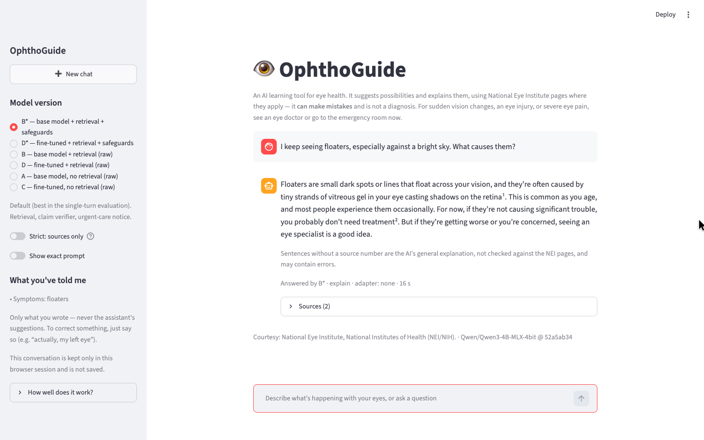
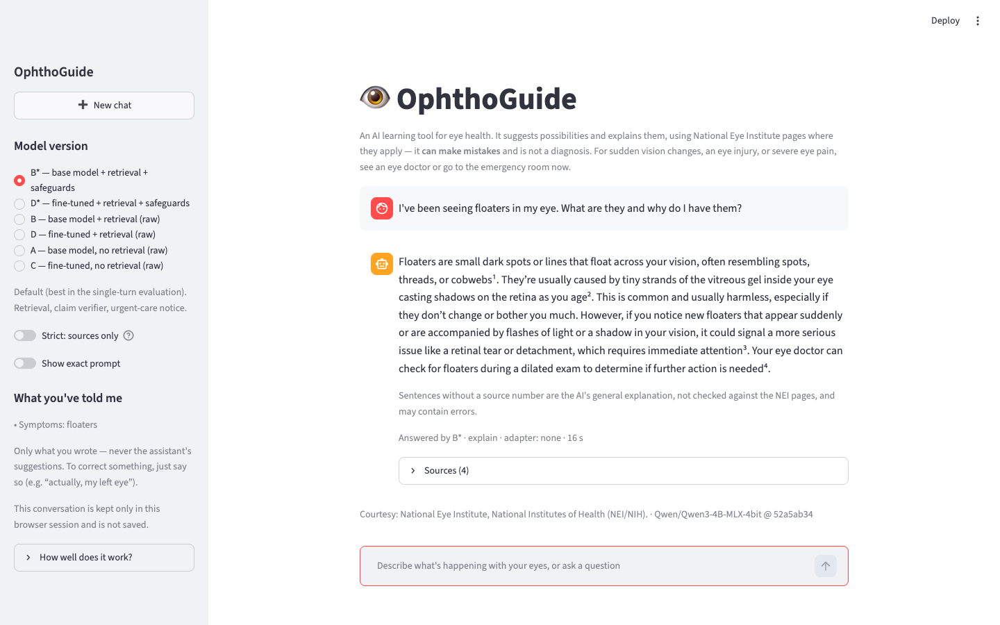
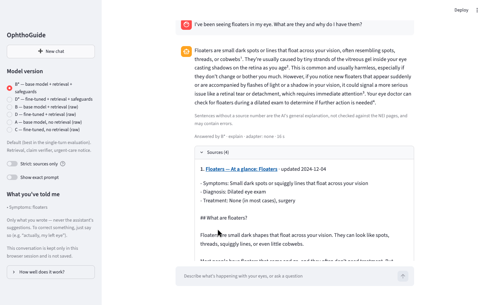
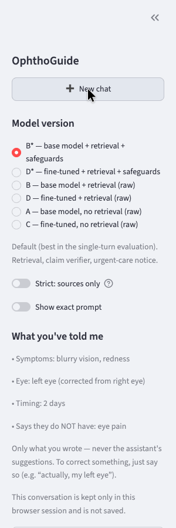
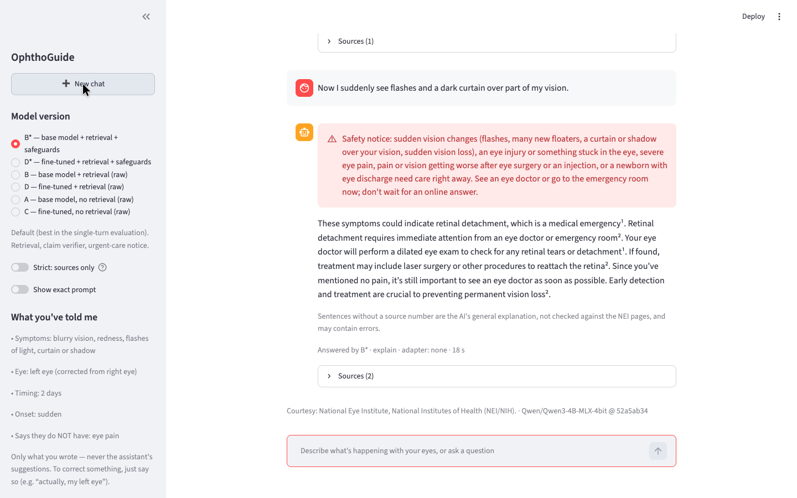
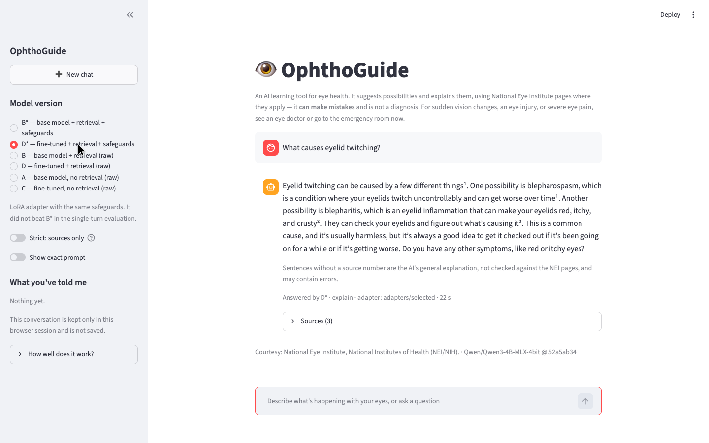

<div align="center">

# 👁 OphthoGuide

**A conversational eye-health guide that explains what might be going on, and shows where every fact comes from.**

Describe what you're noticing in plain words. OphthoGuide suggests likely explanations, answers follow-up questions, remembers what you've told it, and links each sourced sentence to a National Eye Institute page. It runs entirely on a Mac.

[](https://github.com/realjeffreyau/OphthoGuide/actions/workflows/checks.yml)


-1d4ed8)
-1d4ed8)


[Overview](#overview) · [Product tour](#product-tour) · [How it works](#how-it-works) · [Quick start](#quick-start) · [Results](#results) · [Quality gates](#quality-gates) · [Roadmap](#roadmap)

<br />



</div>

---

## Overview

Eye-health information online is either too technical or too vague, and most AI chatbots can't tell you where an answer came from. OphthoGuide explains things the way a patient-friendly clinician would. It keeps every source-backed sentence traceable to a public-domain NEI page and is upfront about the parts that aren't.

| | |
|---|---|
| **Ask the way you'd talk** | Describe a symptom, answer follow-ups in a few words ("Two days", "No pain"), or correct yourself ("Actually, my left eye"). |
| **Possibilities, not boilerplate** | Answers lead with the likely explanations from common to rare, say which are usually harmless, and mention a doctor only when it would change what you should do. |
| **Every source-backed sentence is traceable** | Numbered sentences link to the NEI passage that supports them. Unnumbered sentences are clearly labelled as the AI's general explanation. |
| **Urgent symptoms come first** | Sudden flashes, a curtain over your vision, an eye injury, or worsening pain after surgery trigger a fixed safety notice, reassessed on every turn. |
| **Private and local** | A 4-billion-parameter model runs on your Mac. Conversations live only in browser-session memory; nothing is saved. |

> [!IMPORTANT]
> OphthoGuide is an **educational research project**, not a medical device. It can make mistakes, does not diagnose, has had **no clinician review**, and did **not** meet its own zero-urgent-failure criterion in testing. For sudden vision changes, an eye injury, or severe eye pain, see an eye doctor or go to the emergency room. See [Project boundaries](#project-boundaries).

## Product tour

### 1. Ask a question in plain words

Ask about a symptom or a condition. The default **Explain** style answers directly, suggests possibilities, and keeps the urgent warning signs in view without burying the answer in disclaimers.



### 2. See where every fact comes from

Superscript numbers point to the supporting passages, shown verbatim in an expander under each reply, along with the update date and a link to the NEI page. Anything a source contradicts is removed and listed.



### 3. Follow-ups and corrections are remembered

Short replies are linked to the question they answer. **What you've told me** lists only facts *you* stated: eye, timing, symptoms, symptoms you've ruled out, history, and corrections. A possibility the assistant mentioned never becomes a fact about you. **New chat** clears everything.

<p align="center">
  
</p>

### 4. Urgency is reassessed on every turn

A new symptom can change the situation mid-conversation. Here, flashes and a curtain over the vision trigger the fixed safety notice before the explanation. If search results are weak, the urgent guidance is still shown.



### 5. Compare model versions

The sidebar switches between the default **B\*** (base model with retrieval and safeguards), the fine-tuned **D\***, and raw versions for comparison. Every reply is labelled with the version and adapter that produced it. **Strict: sources only** turns off general explanation entirely.



▶ **Demo video:** [`docs/media/demo.webm`](docs/media/demo.webm). It covers a simple question, sources, follow-ups and a correction, an urgent turn, and a version switch.

## How it works

```text
 your message ──► patient context ──► conversation-aware search ──► Qwen3-4B (MLX, local)
                  (your words only)    BM25 over 72 NEI pages          + optional LoRA adapter
                        │                                                     │
                        ▼                                                     ▼
              urgency check every turn                       claim checker, sentence by sentence
              (fixed safety notice first)                    sourced → numbered · uncovered → labelled
                                                             contradicted → removed
```

- **Patient context from user messages only:** rules extract the eye, timing, onset, symptoms, denials ("no pain"), history, and corrections. The assistant's own text is never parsed into facts.
- **Conversation-aware retrieval:** a reply like "Two days" is searched together with the earlier complaint, and a new topic gets a fresh search. Synonyms the NEI pages use (macular degeneration ↔ AMD, pink eye ↔ conjunctivitis) are added, and conversational filler is dropped.
- **Claim checking:** the model proposes a supporting quote for each sentence and code confirms it's really in the cited passage. Conflict rules catch reversals (early vs later, most vs always), and negated or "less likely" claims are removed unless the passage says so.
- **Bounded memory:** the last 6 messages go to the model word for word. Older turns survive as the structured fact list, so corrections are never lost to a paraphrase.
- **Safety in code, not the prompt:** a 4B model follows conditional rules unreliably, so urgent detection and the safety notice are deterministic.

## Quick start

Requires an **Apple silicon Mac** and **Python 3.14** (tested on 3.14.2).

```bash
python3 -m venv .venv
.venv/bin/pip install -r requirements.txt

# Base model (about 2 GB), pinned to the evaluated revision
.venv/bin/hf download Qwen/Qwen3-4B-MLX-4bit --revision 52a5ab34fa604bc8af6d3ce0cac0cab10b7eb495

.venv/bin/streamlit run app.py
```

Open **http://127.0.0.1:8501** and describe what you're noticing, or ask a question. The demo binds to `127.0.0.1`; keep it local. See [SECURITY.md](SECURITY.md).

<details>
<summary><b>Optional: command line, the fine-tuned adapter, and the exact environment</b></summary>

<br />

```bash
# Single-turn command line (the original evaluated pipeline, security-hardened)
.venv/bin/python scripts/assistant.py "What is glaucoma?" --show-evidence
.venv/bin/python scripts/assistant.py "Can LASIK fix presbyopia?" --adapter adapters/selected

# Rebuild the 72-page chat corpus from the cached NEI pages
.venv/bin/python scripts/collect_sources.py --sources data/sources/nei_pages_chat.csv \
    --out data/processed_chat/documents.jsonl
.venv/bin/python scripts/build_chat_corpus.py
```

- The selected LoRA adapter (checkpoint 200, 7 MB) is in `adapters/selected/`; D\* and D use it.
- `requirements-lock.txt` records the complete evaluated Mac environment; `requirements.txt` lists only the direct dependencies.

To retrain the adapter (about 40 minutes on an M5; peak memory 6.2 GB):

```bash
.venv/bin/mlx_lm.lora --model Qwen/Qwen3-4B-MLX-4bit --train --data data/training \
  --adapter-path adapters/run_01 --batch-size 1 --num-layers 4 --max-seq-length 2048 \
  --grad-checkpoint --mask-prompt --learning-rate 0.00001 --iters 300 \
  --steps-per-eval 50 --val-batches -1 --save-every 50 --seed 42
```

</details>

## Results

There are two separate evaluations, and **their numbers aren't comparable**: they use different tasks, prompts, and pipelines. Everything was scored by an AI (Claude) against the NEI sources, with rules fixed before unblinding. **There has been no clinician review**, so treat these as an honest small-sample study, not evidence of clinical safety.

**Single-turn: a frozen 150-case test set**, run once, with blinded scoring of 240 answers ([full report](data/results/RESULTS.md)). It describes the original evaluated assistant, archived as [non-executable text](data/results/evaluated_snapshot/README.md) with its 7 hashes verified on every push.

| Version | Mean correctness (0–2) | Correct action | Unsupported claims | Unsafe | Useful |
|---|---|---|---|---|---|
| A: base model, no retrieval | 0.60 | 14/60 | 6 | 3 | 28 |
| B: base model + retrieval | **1.25** | **38/60** | 6 | **4** | **45** |
| C: fine-tuned, no retrieval | 0.38 | 13/60 | **2** | 18 | 14 |
| D: fine-tuned + retrieval | 1.08 | **38/60** | **2** | 6 | 38 |

- **Retrieval is the main win:** on the same cases, B beat A in 32 and lost in 6.
- **Fine-tuning did not improve answers:** D beat B in 7 cases and lost in 15. It looked better on validation, but those questions shared templates with the training data.
- **No version met the zero-urgent-failure criterion:** the urgent detector caught 35/35 urgent questions on training and validation, but only 16/21 on the test set.

**Multi-turn chat: 16 dev and 8 held-out conversations** ([full report](data/evaluation_chat/RESULTS.md)).
- **The honest number:** the held-out run before fixes missed the urgent notice in **2 of 8** conversations — a post-surgery red eye with persistent pain (since fixed), and a mild bump that became urgent a turn later.
- **B\* stays the default.** D\* scored lower in chat (0.88 vs 1.13), with template loops and context bleeding between topics.

## Quality gates

Every push runs validation and security checks in [GitHub Actions](.github/workflows/checks.yml). The model-dependent tests run locally on a Mac.

| Command | What it verifies |
|---|---|
| `scripts/validate_documents.py` | Both NEI corpora: schema, dates, public-domain status, no navigation residue |
| `scripts/build_test_cases.py --verify` | The frozen 150-case test set matches its manifest |
| `scripts/verify_evaluated_snapshot.py` | The 7 historical evaluation hashes, including the archived assistant |
| `scripts/test_chat.py` | Conversation logic: follow-ups, corrections, denials, urgency changes, topic changes, truncation, citation and claim checks (no model) |
| `scripts/test_security.py` | Input limits, blank input, no rendered HTML, no internal errors in the UI, bounded parsing |
| `scripts/test_app.py` | End-to-end chat with the real model, including version switching, New chat, and a missing adapter (local only) |
| `scripts/run_chat_eval.py --report B* D*` | Multi-turn evaluation checks (local only) |
| Bandit · pip-audit · Gitleaks · CodeQL | Static analysis, dependency audit of `requirements-lock.txt`, secret and code scans (CI) |

All commands run with `.venv/bin/python`.

<details>
<summary><b>Reproducing the full pipeline</b></summary>

<br />

| Step | Command | Output |
|---|---|---|
| 1. Collect sources | `scripts/collect_sources.py`, then `scripts/validate_documents.py` | `data/processed/documents.jsonl` |
| 2. Chunk and index | `scripts/retrieval.py --build` | `data/processed/chunks.jsonl` |
| 2b. Evaluate retrieval | `scripts/eval_retrieval.py` | hit@4, MRR; `data/eval/retrieval_failures.md` |
| 3. Assistant | `scripts/assistant.py --batch FILE --log OUT` | `data/eval/assistant_review.md` |
| 5. Frozen test set | `scripts/build_test_cases.py --verify` | `data/evaluation/` |
| 6. Training data | `scripts/build_training_data.py`, then `build_test_cases.py --check-train` | `data/training/` |
| 7. LoRA training and selection | see Quick start; `scripts/select_checkpoint.py --run adapters/run_01 --select` | `adapters/selected/` |
| 8. Single-turn scoring | `scripts/score_versions.py auto/blind/report` | `data/results/RESULTS.md` |
| 9. Chat corpus | `scripts/collect_sources.py --sources data/sources/nei_pages_chat.csv …`, then `scripts/build_chat_corpus.py` | `data/processed_chat/` |
| 10. Chat evaluation | `scripts/run_chat_eval.py --version B* --set heldout` | `data/evaluation_chat/` |

The historical runner intentionally refuses to rerun the frozen test with the hardened assistant. For a new experiment, use a separately versioned configuration and a new held-out set.

</details>

## Project boundaries

| ✅ Intended use | ⛔ Not intended for |
|---|---|
| Learning about eye conditions, symptoms, and exams | Diagnosis, triage, or treatment decisions |
| Exploring how grounded, cited AI answers are built | Replacing an eye exam or emergency care |
| Comparing retrieval, fine-tuning, and safeguards | Use without the safety notice, or exposed to the internet |
| Running locally with general questions | Storing or sharing personal health information |

All corpus text comes from [nei.nih.gov](https://www.nei.nih.gov/eye-health-information) and is a U.S. Government work in the public domain (*Courtesy: National Eye Institute, National Institutes of Health*). Copyrighted sources (AAO, Mayo Clinic, Cleveland Clinic, WebMD, A.D.A.M.) were deliberately excluded. The code is [MIT](LICENSE); the base model is not included and is under its own license.

**Known limitations:** one source family (NEI), in English, with no imaging content and no page on screen-related eye strain · in the Explain style, unnumbered sentences are the model's own knowledge and can be wrong · the rule-based urgent detector will miss phrasings it hasn't seen · test sets and scoring come from one AI author, with no inter-rater check.

## Roadmap

1. **Review:** a clinician check of the urgent and missing-information cases in both evaluation sets.
2. **Re-test honestly:** write a new held-out chat set before any further tuning.
3. **Detect urgency better:** replace the regex with a small classifier, evaluated on held-out phrasings.
4. **Retrain for conversation:** multi-turn examples with paraphrased-but-verified answers and no fixed templates, judged against B\* on the new held-out set.
5. **Search better:** hybrid BM25 + embeddings, plus an imaging source (OCT, angiography).

## Documentation

| Area | Documents |
|---|---|
| Learning | [How it was built, step by step](docs/LEARNING_GUIDE.md) |
| Evaluation | [Single-turn results](data/results/RESULTS.md) · [Rubric](data/evaluation/RUBRIC.md) · [Chat results](data/evaluation_chat/RESULTS.md) · [Chat evaluation set](data/evaluation_chat/README.md) |
| Data | [Sources and licensing](data/SOURCES.md) · [Training data](data/training/README.md) · [Retrieval failures](data/eval/retrieval_failures.md) · [Assistant review](data/eval/assistant_review.md) |
| Security | [Security policy](SECURITY.md) · [Publication review](docs/SECURITY_REVIEW.md) |
| Project | [License](LICENSE) |

---

<div align="center">
<sub>Built for learning about eye health. All conversations in this repository and its screenshots are scripted examples. Courtesy: National Eye Institute, National Institutes of Health (NEI/NIH).</sub>
</div>
