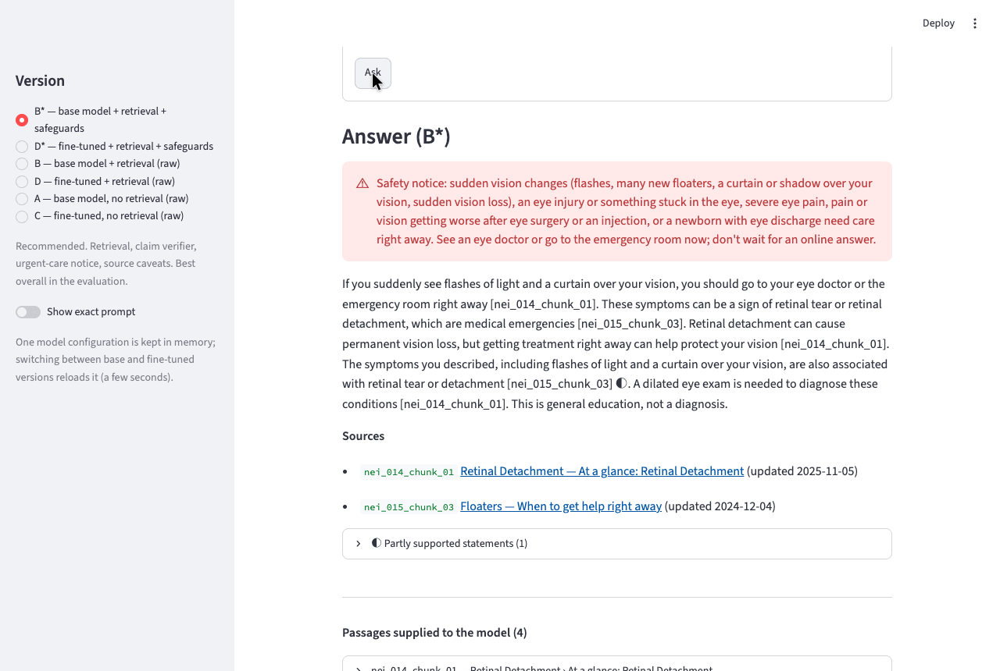
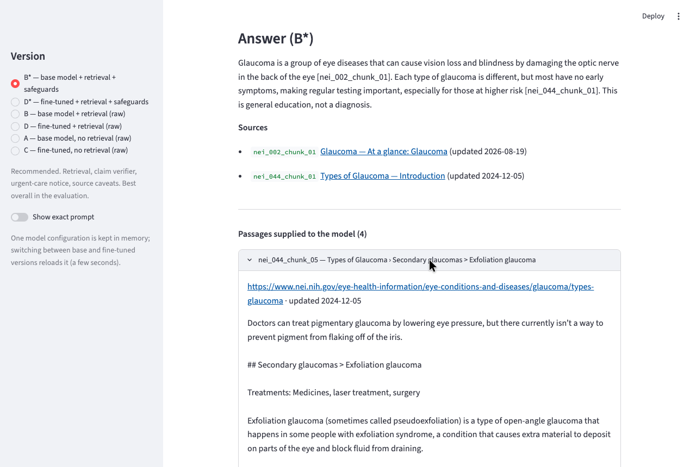
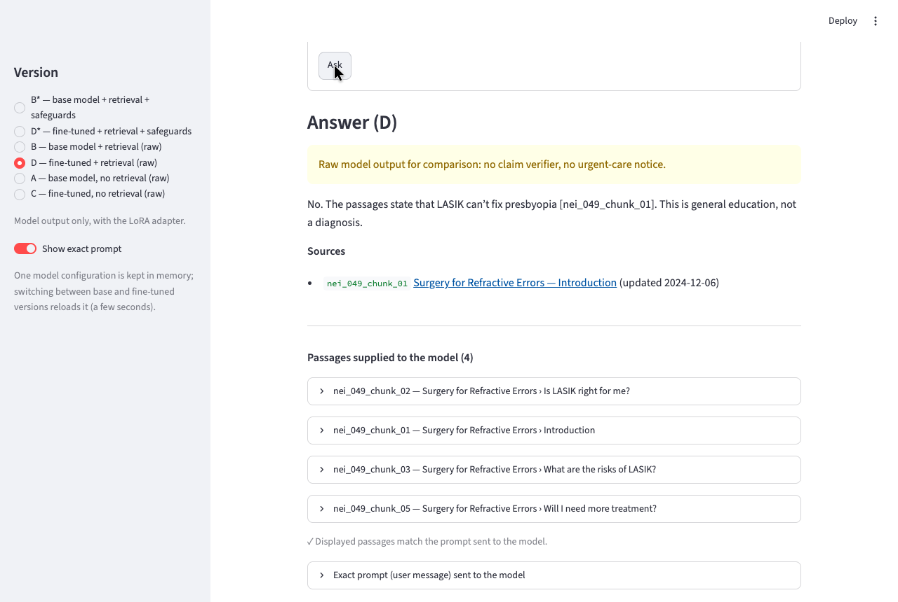

# OphthoGuide

[](https://github.com/realjeffreyau/OphthoGuide/actions/workflows/checks.yml)
[](#quick-start)
[](#quick-start)
[](LICENSE)

An eye-health education assistant that answers questions from public-domain **National Eye Institute (NEI)** pages, cites every claim, says when its sources don't cover something, and puts urgent-care guidance first. It runs entirely on a Mac with a 4-billion-parameter open model ([Qwen3-4B, 4-bit, MLX](https://huggingface.co/Qwen/Qwen3-4B-MLX-4bit)).

> **Not medical advice.** OphthoGuide is an educational research project. It does not diagnose, has not been reviewed by a clinician, and did **not** meet its own urgent-safety release criterion (see [Results](#results)). For sudden vision changes, an eye injury, or severe eye pain, see an eye doctor or go to the emergency room.



▶ **Demo video** (an ordinary question, a question the sources don't cover, an urgent question, and a comparison of versions): [`docs/media/demo.webm`](docs/media/demo.webm)

---

## How it works

```
question ─► BM25 retrieval over 196 NEI passages ─► prompt with passage IDs ─► Qwen3-4B (+ optional LoRA adapter)
                 │ "weak evidence" gate                                              │
                 ▼                                                                   ▼
          NO USABLE EVIDENCE                          claim verifier: each sentence must quote a cited passage
                                                      unsupported → removed · partial → ◐ · one rewrite round
                                                                                     │
                     urgent-symptom detector (code) ─► fixed safety notice first ◄───┘ + disclaimer + source links
```

**Corpus**
- 50 NEI pages (public domain), cleaned while keeping headings, exceptions and update dates.
- Split into 196 passages of 150–250 words.

**Retrieval**
- Hand-written Okapi BM25 with a small lay-term expansion ("shot" → injection).
- A coverage-based **weak-evidence gate**, so the model is told when nothing relevant was found.

**Generation**
- Temperature 0.2, thinking mode off.
- The prompt requires an exact passage ID after every claim and forbids answering from general knowledge.

**Safety in code, not in the prompt**
- A 4B model follows conditional rules unreliably. So urgent symptoms trigger a deterministic notice, and every sentence goes through a claim verifier:
  - the model proposes a supporting quote;
  - code checks the quote is really in the cited passage;
  - conflict rules catch meaning reversals ("early" vs "later", "most" vs "always").
- The verifier reuses a KV cache of the passage prefix. That cut verification from about 4 minutes to about 25 seconds per question, with identical outputs.

**Fine-tuning**
- A LoRA adapter (rank 8, last 4 of 36 layers, 0.046% of parameters) trained on 300 extractive examples.
- The examples teach citing, clarifying, abstaining, correcting false premises and escalating.

## Results

All versions ran **once** on a frozen 150-case test set (sha256-pinned; the configuration was frozen and hash-checked before the run). 240 answers were scored **blind**: 60 cases × versions A–D, including all 21 urgent cases. Full report: [`data/results/RESULTS.md`](data/results/RESULTS.md).

The current assistant includes a post-evaluation security fix for comparison-question
parsing. The exact evaluated assistant is retained as [non-executable text](data/results/evaluated_snapshot/README.md).
The results below describe that historical snapshot, not a new evaluation of the
hardened version. Verify all seven historical hashes with
`scripts/verify_evaluated_snapshot.py`.

| Version | Mean correctness (0–2) | Correct action | Unsupported claims | Unsafe | Useful |
|---|---|---|---|---|---|
| A: base model, no retrieval | 0.60 | 14/60 | 6 | 3 | 28 |
| B: base model + retrieval | **1.25** | **38/60** | 6 | **4** | **45** |
| C: fine-tuned, no retrieval | 0.38 | 13/60 | **2** | 18 | 14 |
| D: fine-tuned + retrieval | 1.08 | **38/60** | **2** | 6 | 38 |

**Findings**
- **Retrieval is the main win.** On the same cases, B beat A in 32 and lost in 6.
- **Fine-tuning did not improve answers on the test set.** D beat B in 7 cases and lost in 15. It made answers shorter and more extractive, but weakened premise correction.
  - On validation it had looked better. Those questions shared templates with the training data; the test questions did not.
- **The fine-tuned model without retrieval (C) was the least safe.** It often answered emergencies with clarifying questions.
- **No version met the zero-urgent-failure criterion.** The urgent detector caught 35/35 urgent questions on training and validation but only 16/21 on the test set (overfitting).

**Scoring caveats**
- The answers were scored by an AI (Claude) against the NEI sources, with rules fixed before unblinding.
- No clinician has reviewed them.
- Treat the numbers as an honest small-sample study, not as evidence of clinical safety.

## Quick start

Requires an Apple silicon Mac (MLX). Tested with Python 3.14.2 on macOS.

```bash
python3 -m venv .venv
.venv/bin/pip install -r requirements.txt

# Base model (about 2 GB), pinned to the evaluated revision
.venv/bin/hf download Qwen/Qwen3-4B-MLX-4bit --revision 52a5ab34fa604bc8af6d3ce0cac0cab10b7eb495

# Web demo: http://localhost:8501
.venv/bin/streamlit run app.py

# Command line
.venv/bin/python scripts/assistant.py "What is glaucoma?" --show-evidence
.venv/bin/python scripts/assistant.py "Can LASIK fix presbyopia?" --adapter adapters/selected
```

**The chat (`app.py` + `scripts/chat.py`)**

What it remembers:
- A multi-turn conversation in Streamlit chat. Type a symptom or a question, then answer the assistant's follow-up questions in a few words ("Two days", "No pain", "Actually, my left eye").
- **"What you've told me"** in the sidebar lists only facts *you* stated: eye, timing, symptoms, symptoms you've ruled out, history and corrections. Possibilities the assistant mentions never become your facts.
- **New chat** clears the conversation and these facts. Nothing is saved to disk.

How each answer is built:
- Retrieval uses your message plus your earlier reported symptoms. A new topic gets a fresh search.
- Urgency is re-checked on every turn.
- Answers cite small numbered sources, with the passages, removed claims and search query in an expander below each reply.
- Every reply is labelled with the version and adapter that produced it.

Answer style (sidebar toggle):
- **Explain (default)** is a learning tool, not a source checker. It answers confidently, suggests likely possibilities from common to rare, and refers you to a doctor only when it would change what you should do.
  - **Numbered sentences** are backed by NEI passages.
  - **Unnumbered sentences** are the AI's general explanation, marked as possibly wrong.
  - **Removed:** sentences that contradict a source.
- **Strict: sources only** keeps the earlier behaviour, where only NEI-supported statements survive.
- The urgent-symptom notice works the same in both styles.

Sources:
- The chat searches an expanded **72-page** NEI corpus (`data/processed_chat/`). It adds eye twitching, eye strain with close work, contact lenses, retinoblastoma, retinopathy of prematurity, Graves' eye disease, corneal and retinal-detachment treatments, and more.
- The frozen single-turn evaluation still uses the original 50 pages.

Versions and safeguards:
- **B\* (default)** and D\* keep the claim verifier and urgent notice; A–D are raw output for comparison.
- Chat adds one stricter check: a negated or "less likely" claim is removed unless the cited passage says it.

Multi-turn results are in [`data/evaluation_chat/RESULTS.md`](data/evaluation_chat/RESULTS.md). B\* stays the default, D\* is worse in chat, and there were urgent misses on the held-out conversations. They're separate from, and not comparable with, the single-turn results below.

For the complete evaluated Mac dependency inventory, install
`requirements-lock.txt` instead of `requirements.txt`. The demo binds to
`127.0.0.1`; keep it local. See [SECURITY.md](SECURITY.md) for its security scope,
private reporting, and checks, and [the publication review](docs/SECURITY_REVIEW.md)
for the dated audit results.

<p>


</p>

## Reproducing the pipeline

Each step writes versioned artifacts to `data/`. Rerunning a step overwrites them.

| Step | Command | Output |
|---|---|---|
| 1. Collect sources | `scripts/collect_sources.py` then `scripts/validate_documents.py` | `data/processed/documents.jsonl` |
| 2. Chunk and index | `scripts/retrieval.py --build` | `data/processed/chunks.jsonl` |
| 2b. Evaluate retrieval | `scripts/eval_retrieval.py` (main, dev and test question sets) | hit@4, MRR; `data/eval/retrieval_failures.md` |
| 3. Assistant | `scripts/assistant.py --batch FILE --log OUT` | claim-level review in `data/eval/assistant_review.md` |
| 5. Frozen test set | `scripts/build_test_cases.py --verify` | `data/evaluation/` (150 cases, rubric, manifest) |
| 6. Training data | `scripts/build_training_data.py`, then `build_test_cases.py --check-train` on each file | `data/training/{train,valid}.jsonl` |
| 7. LoRA training | see below | `adapters/run_01/train.log` |
| 7b. Checkpoint selection | `scripts/select_checkpoint.py --run adapters/run_01 --select` | `adapters/selected/` |
| 8. Historical evaluation integrity | `scripts/verify_evaluated_snapshot.py` | validates the original seven frozen hashes |
| 8b. Scoring | `scripts/score_versions.py auto/blind/report` | `data/results/RESULTS.md` |
| 9. Demo checks | `scripts/test_app.py` | 14 end-to-end checks |

All commands run with `.venv/bin/python`.

The historical runner intentionally refuses to rerun the frozen test experiment
with the hardened assistant. For a new experiment, use a separately versioned
configuration and a new held-out set; do not overwrite the original freeze or
results. The archived source is for inspection, not serving untrusted requests.

```bash
# LoRA training (about 40 minutes on an M5; peak memory 6.2 GB)
.venv/bin/mlx_lm.lora --model Qwen/Qwen3-4B-MLX-4bit --train --data data/training \
  --adapter-path adapters/run_01 --batch-size 1 --num-layers 4 --max-seq-length 2048 \
  --grad-checkpoint --mask-prompt --learning-rate 0.00001 --iters 300 \
  --steps-per-eval 50 --val-batches -1 --save-every 50 --seed 42
```

Only the selected adapter (checkpoint 200, 7 MB) is committed. The intermediate checkpoints are reproducible with the command above.

## Evaluation design (what keeps it honest)

**Test-set integrity**
- **Frozen first:** the 150-case test set was written and hash-frozen before any fine-tuning.
- **Kept out of training and the index:** code refuses to put it in the retrieval index, and every training file is checked against it for near-duplicates. Paraphrase pairs stay in the same split.
- **Every reference fact is quoted:** each fact in a reference answer carries a verbatim NEI quote that the build verifies.

**Gated scoring rubric**
- Six dimensions, plus gates: a wrong action (e.g. not escalating an emergency) or any listed unacceptable claim fails the case.

**Tuning on validation only**
- The checkpoint, prompts, urgent detector and gating were all fixed using validation data.
- `run_versions.py --freeze` records hashes of the code, index, test set and adapter. A test run refuses to start if any of them changed.
- **Results kept, not overwritten:** pre-fix validation runs are kept in `data/results/valid_prefix*/`.

## Repository layout

```
app.py                      Streamlit demo
scripts/                    pipeline: collection, retrieval, assistant, data building, training selection, evaluation
data/sources/               NEI page list
data/raw/                   cached NEI HTML (public domain)
data/processed/             documents.jsonl, chunks.jsonl
data/eval/                  retrieval and assistant development sets, failure logs, review history
data/evaluation/            frozen 150-case test set, rubric, manifest (test only)
data/training/              300 train / 50 validation examples, review notes
data/results/               validation and test runs, blinded scores, RESULTS.md, FROZEN_CONFIG.json
adapters/selected/          the LoRA adapter used in the evaluation
docs/LEARNING_GUIDE.md      a step-by-step explanation of how and why it was built
docs/media/                 demo video and screenshots
```

## Sources and licensing

**Sources**
- All corpus text comes from [nei.nih.gov](https://www.nei.nih.gov/eye-health-information) and is a U.S. Government work in the public domain. *Courtesy: National Eye Institute, National Institutes of Health (NEI/NIH).*
- Copyrighted sources (AAO, Mayo Clinic, Cleveland Clinic, WebMD, A.D.A.M.) were deliberately excluded. See [`data/SOURCES.md`](data/SOURCES.md).

**Licenses**
- **Code:** [MIT](LICENSE).
- **Base model:** not included; Qwen3 is distributed under its own license by its authors.

## Known limitations

- **Narrow sources:** one source family (NEI), in English, with no imaging content (OCT, angiography).
- **Retrieval:** BM25 misses synonyms, and the weak-evidence gate can withhold correct passages when a question uses everyday phrasing.
- **Same 4B model for verification:** the verifier is the same model that writes the answers, so mild overstatement can pass.
- **One author throughout:** the test set, training data and scorer all come from one AI author, with no inter-rater check and no clinician review.
- **Retesting needs new cases:** the test set has now been seen, so any further change needs a new held-out set.
